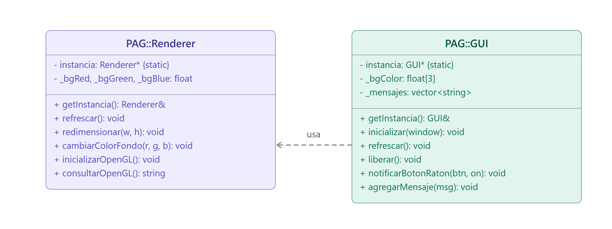
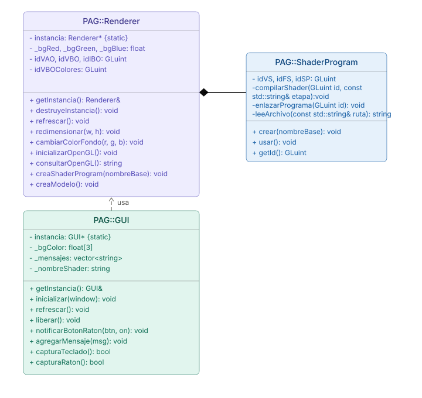
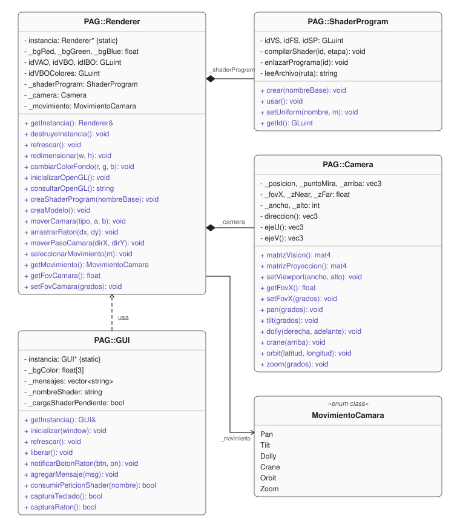


# Práctica 2 - Lucía Cano Cubillo

## Explicación de los cambios realizados

### PAG::Renderer (patrón Singleton)

Toda la lógica que antes llamaba directamente a funciones de OpenGL desde
`main.cpp` (`glClear`, `glClearColor`, `glViewport`, `glEnable`,
`glGetString`) se ha movido a una clase `PAG::Renderer`, implementada
como Singleton (atributo estático privado, constructor privado, acceso
único mediante `getInstancia()` con inicialización perezosa).

Como resultado, `main.cpp` ya no contiene ninguna llamada directa a
funciones de OpenGL: solo llama a GLFW, GLAD, y a los métodos públicos de
`PAG::Renderer` y `PAG::GUI`.

### PAG::GUI (patrón Singleton)

Siguiendo la Figura 4 del guion, se ha creado una segunda clase
Singleton, `PAG::GUI`, que encapsula toda la comunicación con Dear ImGui.
Ni `main.cpp` ni `PAG::Renderer` incluyen ninguna cabecera de ImGui.
Cuando el usuario cambia el color en el selector, `GUI` delega en
`Renderer::cambiarColorFondo(...)` en vez de tocar OpenGL directamente.

### Controles de Dear ImGui

- **Ventana "Fondo"**: un `ColorPicker3` con rueda de tono para cambiar
  el color de fondo de la escena de forma interactiva.
- **Ventana "Mensajes"**: sustituye la consola como salida de mensajes
  de la aplicación (arranque, info de OpenGL, teclas, botones del ratón,
  scroll, errores de GLFW).

### Reenvío de eventos de ratón a Dear ImGui

Como GLFW solo permite un callback por tipo de evento y ventana, al
registrar `mouse_button_callback` propio se sobrescribía el callback que
Dear ImGui instala automáticamente. Se soluciona notificando el evento
manualmente a `PAG::GUI`, que reenvía el evento a Dear ImGui.

## Diagrama de clases

`main.cpp` inicializa y usa tanto `PAG::Renderer` como `PAG::GUI` (ambos
Singleton). `PAG::GUI` depende de `PAG::Renderer` únicamente para
comunicarle el nuevo color de fondo; ninguna de las dos clases conoce la
biblioteca de la otra por dentro.

## Nota sobre dependencias

Dear ImGui no se incluye en el repositorio (ver `.gitignore`); es
necesario descargarlo desde https://github.com/ocornut/imgui.

# Práctica 3 - Lucía Cano Cubillo

## Explicación de los cambios

Partiendo de la práctica 2, en esta sesión se ha añadido el renderizado de un triángulo:

- **Geometría y shaders en `PAG::Renderer`**: se han añadido los atributos para los identificadores de VAO, VBO, IBO y shaders, junto con los métodos `creaShaderProgram()` y `creaModelo()` para crearlos.

- **Comprobación de errores con excepciones**: tanto la compilación de cada shader (`compilarShader`) como el enlazado del shader program (`enlazarPrograma`) comprueban su resultado y, si falla, lanzan una `std::runtime_error` con el log que devuelve OpenGL. Estas excepciones se capturan en `main.cpp` y el mensaje de error se muestra en la ventana de Mensajes de la interfaz, en vez de cerrar la aplicación.

- **Shaders en archivos externos**: el código GLSL ya no está embebido como texto en `Renderer.cpp`, sino en los archivos `pag03-vs.glsl` y `pag03-fs.glsl`, que se leen con el método `leeArchivo()`. El CMakeLists.txt copia estos archivos al directorio de ejecución.

- **Color por vértice**: se ha añadido un segundo atributo (color) a la geometría, interpolado entre los tres vértices del triángulo (rojo, verde y azul). Se ha implementado con un único VBO entrelazado (posición y color en el mismo array); la versión alternativa con dos VBOs separados se ha dejado comentada en el código, en `creaModelo()`.

- **Limpieza de `main.cpp`**: los callbacks de refresco y redimensionado ya no escriben en consola, sino que envían sus mensajes a la ventana de Mensajes de la GUI, y se ha corregido el nombre del parámetro `errno` del callback de errores por conflicto con la macro del mismo nombre.

## ¿Por qué se deforma el triángulo al redimensionar la ventana?

El triángulo lo dibujamos con unas coordenadas fijas, entre -1 y 1, y el shader no hace nada más que colocarlas tal cual están, sin ningún cálculo extra.

El problema es que, para pintar esas coordenadas en la ventana, OpenGL las estira hasta ocupar todo el área de dibujo, es decir, todo el ancho y todo el alto que tenga la ventana en ese momento (esto lo hacemos con `glViewport`, que llamamos cada vez que la ventana cambia de tamaño).

Si la ventana no es cuadrada, esa transformación escala el eje X y el eje Y en proporciones distintas, así que el triángulo se ensancha o se estrecha según la relación de aspecto de la ventana en cada momento. Por eso el triángulo se ve estirado o aplastado según la forma que tenga la ventana en cada momento.

# Práctica 4 - Lucía Cano Cubillo

En esta práctica se ha sacado la gestión de los shaders de `PAG::Renderer`
y se ha añadido a la interfaz un control para cargarlos.

## Cambios realizados

- **Nueva clase `PAG::ShaderProgram`:** se encarga de leer, compilar y
  enlazar los shaders, y de liberarlos al terminar. Antes todo esto
  estaba dentro de `Renderer`.
- **`PAG::Renderer`:** ahora tiene un `ShaderProgram` y le delega todo lo
  relacionado con los shaders.
- **`PAG::GUI`:** nueva ventana "Shader Program" con una caja de texto
  para el nombre base de los shaders (por ejemplo `pag03`) y un botón
  "Load". Si la carga falla, el error aparece en la ventana de mensajes.
- **`main.cpp`:** ya no carga ningún shader ni contiene nombres de
  archivo. El usuario los carga desde la interfaz.
- **Teclado y ratón:** si Dear ImGui está usando un evento (por ejemplo,
  al escribir en la caja de texto), nuestros callbacks lo ignoran.

## Decisiones de diseño

- **`ShaderProgram` no es un Singleton:** en futuras prácticas puede
  hacer falta más de un shader program, y un Singleton lo impediría.
- **Si la carga falla, no se pierde el shader anterior:** el nuevo
  shader program solo sustituye al actual si se ha creado sin errores,
  así que el triángulo sigue visible.
- **Cada clase tiene una única responsabilidad:** `Renderer` dibuja,
  `ShaderProgram` gestiona los shaders y `GUI` se ocupa de la
  interfaz. `GUI` solo usa `Renderer` para avisarle del color de fondo
  y de la carga de shaders.

# Práctica 5 - Lucía Cano Cubillo

En esta práctica se ha añadido una cámara virtual cuyos movimientos se
controlan con el ratón, el teclado y una ventana de ImGui.

## Cambios realizados

- **Nueva clase `PAG::Camera`:** guarda la posición de la cámara, el punto
  al que mira, el ángulo de visión horizontal, los planos near y far y el
  tamaño del viewport. Con ellos calcula la matriz de visión
  (`glm::lookAt`) y la de proyección (`glm::perspective`). También
  implementa los movimientos pan, tilt, dolly, crane, orbit y zoom.
- **Nuevo enumerado `MovimientoCamara`:** identifica el movimiento que
  está seleccionado.
- **`PAG::Renderer`:** tiene una `Camera`. En cada refresco multiplica
  las matrices de proyección y de visión y se las pasa al vertex shader
  como uniform (`mModelViewProj`). También convierte el ratón, las teclas
  y los botones en movimientos de cámara.
- **`PAG::ShaderProgram`:** nuevo método `setUniform` para enviar una
  matriz al shader.
- **`PAG::GUI`:** nueva ventana "Camera" con un desplegable para elegir
  el movimiento y botones que cambian según el movimiento elegido.
- **`main.cpp`:** nuevos callbacks para arrastrar con el ratón y para las
  teclas de flecha. Además, ahora es `main.cpp` quien carga el shader
  cuando se pulsa "Load" y quien escribe el mensaje de éxito o de error
  (la `GUI` solo avisa de que se ha pulsado el botón).
- **Vertex shader:** ahora multiplica la posición de cada vértice por
  `mModelViewProj`.

## Decisiones de diseño

- **La cámara guarda el ángulo horizontal**, como pide el enunciado, y
  calcula el vertical que necesita `glm::perspective`.
- **Pan y tilt** giran el punto al que mira la cámara sin mover la
  cámara. **Dolly y crane** mueven a la vez la cámara y el punto al que
  mira (dolly en el plano XZ y crane en el eje Y). **Orbit** mueve la
  cámara alrededor del punto al que mira.
- **Límite de 89 grados** en tilt y orbit, para evitar la situación
  anómala de mirar justo hacia arriba o hacia abajo.
- **El zoom** cambia el ángulo de visión, que se limita entre 5 y 120
  grados.
- **El `Renderer` coordina todo:** ratón, teclas y botones llaman al
  `Renderer`, y este mueve la cámara. Así hay un único sitio donde se
  decide qué hace cada movimiento.
- **Los mensajes solo se escriben desde `main.cpp`**, como pide el
  enunciado. Por eso la carga del shader se hace en `main.cpp`.

## Instrucciones de uso

1. Pulsa "Load" en la ventana "Shader Program" para cargar los shaders
   (por ejemplo `pag03`).
2. En la ventana "Camera", elige el movimiento en el desplegable
   "Movement".
3. Mueve la cámara de una de estas formas:
  - Arrastrando con el botón izquierdo del ratón sobre la escena.
  - Con los botones de la ventana "Camera".
  - Con las flechas del teclado:

   | Movimiento | Izquierda / Derecha | Arriba / Abajo |
      |------------|---------------------|----------------|
   | Pan        | gira a izquierda / derecha | - |
   | Tilt       | - | mira arriba / abajo |
   | Dolly      | se desplaza a izquierda / derecha | avanza / retrocede |
   | Crane      | - | sube / baja |
   | Orbit      | gira en longitud | gira en latitud |
   | Zoom       | - | acerca / aleja |

4. La rueda del ratón sigue cambiando el color de fondo.
